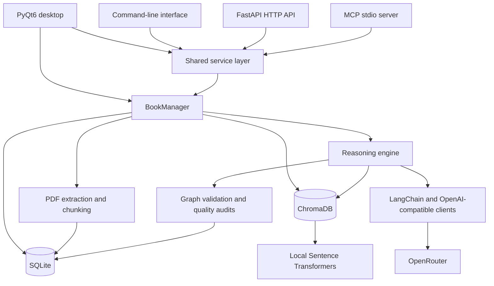

# Jake's Proper Thinking AI

**Turn books into source-grounded answers, structured thinking frameworks, and interactive maps of ideas.**

Jake's Proper Thinking AI is a Python desktop application for working with the reasoning inside a book. Import a PDF, build a searchable local library, ask questions with page references, and extract a framework of definitions, principles, steps, warnings, and constraints.

The same backend is available through a desktop interface, a command-line interface, an HTTP API, and a Model Context Protocol (MCP) server. Books and generated artifacts are stored locally; AI reasoning uses models accessed through OpenRouter.

[Repository](https://github.com/onfire7777/Proper-Thinking-AI) · [CLI reference](CLI.md) · [Quick start](#quick-start) · [Architecture](#architecture) · [MCP integration](#mcp-integration)

## Contents

- [What it does](#what-it-does)
- [Quick start](#quick-start)
- [Using the desktop app](#using-the-desktop-app)
- [Architecture](#architecture)
- [How framework generation works](#how-framework-generation-works)
- [Configuration and model routing](#configuration-and-model-routing)
- [Command-line interface](#command-line-interface)
- [HTTP API](#http-api)
- [MCP integration](#mcp-integration)
- [Local data and privacy](#local-data-and-privacy)
- [Windows builds](#windows-builds)
- [Development and verification](#development-and-verification)
- [Troubleshooting and limits](#troubleshooting-and-limits)

## What it does

| Capability | What you can do |
| --- | --- |
| PDF library | Import PDFs; preserve page references; store extracted text, chunks, and book metadata. |
| Semantic search | Find relevant passages by meaning using local sentence embeddings and a separate ChromaDB collection for each book. |
| Book Q&A | Ask questions against a selected book using retrieval-augmented generation (RAG), with source excerpts and page references. |
| Persistent chat | Create, rename, revisit, and delete conversations associated with a book. |
| Framework extraction | Organize a book's ideas into definitions, governing and operational principles, actionable steps, warnings, and constraints. |
| Quality checks | Inspect logic audits, claim labels, scope assessments, and deterministic checks on framework structure and source grounding. |
| Interactive mindmaps | Explore framework relationships in a force-directed graph with fit, reset zoom, and automatic arrangement controls. |
| Export | Read the canonical Markdown framework or export it to Word (`.docx`) and PDF. |
| Automation | Use the CLI, HTTP endpoints, or MCP tools to access the same library and generation workflows. |

The Q&A prompts require answers to use the supplied source material and instruct the model to return **"Not supported by the source."** when the excerpts do not support an answer. These are grounding safeguards, not a guarantee that every generated claim is correct.

## Quick start

### Requirements

- Git and a 64-bit Python 3 installation compatible with [requirements.txt](requirements.txt).
- A desktop environment for the PyQt interface. Windows packaging scripts are included.
- Internet access for dependency installation and the initial embedding-model download.
- An OpenRouter API key and access to the selected models for AI Q&A and framework generation.

The repository does not currently declare a minimum Python version or provide a fully locked dependency set. Several application dependencies are pinned, while others use minimum-version constraints.

### 1. Clone and install

From PowerShell on Windows:

```powershell
git clone https://github.com/onfire7777/Proper-Thinking-AI.git
cd Proper-Thinking-AI
py -m venv .venv
.\.venv\Scripts\Activate.ps1
python -m pip install --upgrade pip
python -m pip install -r requirements.txt
```

On macOS or Linux, the equivalent environment setup is:

```bash
git clone https://github.com/onfire7777/Proper-Thinking-AI.git
cd Proper-Thinking-AI
python3 -m venv .venv
source .venv/bin/activate
python -m pip install --upgrade pip
python -m pip install -r requirements.txt
```

Windows is the supplied packaging target; these shell commands do not imply that every platform or Python version has been tested.

### 2. Open the desktop app

```powershell
python main.py
```

In **Settings**, enter your OpenRouter API key, choose a primary model and quality mode, save, and test the connection. The settings are saved in `data/config.json`.

### 3. Build your first framework

1. Open **Upload** and select a PDF with extractable text.
2. Open **Library** and generate embeddings for that book.
3. Use **Chat** to ask a question about the book.
4. Open **Frameworks**, select the book, and generate a named framework.
5. Review the framework and its quality audit before using it.
6. Explore its relationships in **Mindmap**, or export the framework to DOCX or PDF.

The first embedding run may take longer while Sentence Transformers downloads `all-MiniLM-L6-v2`. Subsequent runs can reuse the cached model.

## Using the desktop app

| Tab | Purpose |
| --- | --- |
| **Settings** | Configure the OpenRouter key, primary model, and task-routing preset; preview model assignments and test connectivity. |
| **Upload** | Import PDF books, including batches, and extract their text and metadata. |
| **Library** | Inspect uploaded books and embedding status, generate embeddings, and remove books. |
| **Chat** | Ask source-grounded questions and manage saved conversations for the selected book. |
| **Frameworks** | Generate and regenerate frameworks, inspect their structured document and audits, and export results. |
| **Mindmap** | Explore the selected book's framework graph in an embedded WebEngine view. |

The interface supports light and dark themes. Upload and embedding work use Qt worker threads; framework generation also reports progress through its job workflow.

## Architecture

The application separates its entry points, shared operations, reasoning pipeline, ingestion, and persistence.



### Main components

| Component | Responsibility | Location |
| --- | --- | --- |
| Desktop | Qt windows, tabs, themes, workers, chat rendering, and embedded graph view. | [`src/ui/`](src/ui/) |
| CLI | Argument parsing, JSON output, Markdown output, and job polling. | [`src/cli/`](src/cli/) |
| Service layer | Shared operations for books, settings, conversations, frameworks, exports, and graph payloads. | [`src/api/service.py`](src/api/service.py) |
| HTTP / MCP | Expose shared operations as REST endpoints and MCP tools. | [`src/api/`](src/api/) |
| Book manager | Coordinate ingestion, persistence, embeddings, framework jobs, and their lifecycle. | [`src/core/book_manager.py`](src/core/book_manager.py) |
| Reasoning | Retrieve evidence, normalize framework nodes, enrich source context, and coordinate analysis passes. | [`src/core/reasoning.py`](src/core/reasoning.py) |
| Framework pipeline | Extract structured ideas, build and repair graphs, run audits, and render the definitive document. | [`src/core/langchain_framework.py`](src/core/langchain_framework.py) |
| Ingestion | Extract PDF text and metadata, then create paragraph-based chunks with page references. | [`src/ingestion/`](src/ingestion/) |
| Storage | Persist library records in SQLite and per-book vector collections in ChromaDB. | [`src/storage/`](src/storage/) |
| Configuration | Resolve application paths, saved settings, themes, and task-specific models. | [`src/core/app_config.py`](src/core/app_config.py) |

The desktop binds its `BookManager` into the shared service layer. CLI, HTTP, and MCP processes initialize their own manager against the same on-disk data. They do not require the desktop window to be open.

### Technology stack

| Layer | Technologies |
| --- | --- |
| Desktop and graph rendering | PyQt6, PyQt6-WebEngine, bundled vis-network JavaScript |
| PDF ingestion | pypdf |
| Local persistence | Python SQLite support, ChromaDB |
| Embeddings | Sentence Transformers and PyTorch; default model: `all-MiniLM-L6-v2` |
| AI orchestration | LangChain Core, LangChain OpenAI, OpenAI-compatible clients, OpenRouter |
| HTTP and integrations | FastAPI, Uvicorn, MCP Python SDK |
| Document export | python-docx, Qt text rendering and print support |
| Windows distribution | PyInstaller specifications, hooks, and PowerShell build scripts |

## How framework generation works

Frameworks are built through several analysis and validation passes, rather than one free-form summary prompt.

1. **Retrieve evidence.** Search five topic buckets: core framework ideas, warnings, philosophy, ethics, and examples. Deduplicate results, expand neighboring chunks where applicable, and order the evidence by source location. Default limits are 58 chunks and approximately 68,000 context characters.
2. **Extract structured nodes.** Identify sections, definitions, principles, steps, warnings, constraints, cases, and examples. Validate their types and references, split compounded definitions, and attach raw book excerpts.
3. **Enrich usable fields.** Add fields such as operational tests, required concepts, step actions, completion criteria, warning symptoms, and constraint mitigations. Missing source support is represented as a gap.
4. **Build relationships.** Combine model-generated edges with deterministic dependency rules. Normalize the relationship taxonomy and infer applicable definition links.
5. **Assess claims and logic.** Label claims as fact, interpretation, or assumption. Run a logic audit and a bounded graph-repair loop to identify contradictions, missing links, and unsupported structure.
6. **Assess purpose and scope.** Generate internal metadata, target-audience analysis, overview prose, and claimed versus evidenced scope.
7. **Render and check.** Produce the canonical nine-section Markdown document, then run deterministic mechanical checks and bounded repairs for supported structural issues.
8. **Review whether another extraction is warranted.** A judgment audit can request a revised extraction. Re-extraction requires the mechanical audit to pass and remains bounded by the configured iteration limit.

Audit outcomes and progress are persisted with the framework. **A completed generation job is not the same as a passing quality audit**; inspect both before relying on a result.

### The definitive framework document

| Section | Content |
| --- | --- |
| 1. Metadata | Book identity, author, edition/ISBN when available, page-numbering basis, audience, and generation metadata. |
| 2. Overview | The problem, core argument, method, document structure, and claimed versus evidenced applicability. |
| 3. Definitions | Terms, boundaries, dependencies, source support, and operational tests. |
| 4. Principles | Governing and operational principles, including their relationship to execution. |
| 5. Steps | Ordered actions, dependencies, completion criteria, and practical examples where available. |
| 6. Warnings | Failure conditions, symptoms, and links to the steps they affect. |
| 7. Constraints | Limits, affected steps, and mitigations supported by the source. |
| 8. Dependency Map | Relationships among concepts and actions. |
| 9. Scope and Limits | Scope conditions, methodological limits, acknowledged gaps, and an internal-tensions section. |

The document renderer currently exports sections 1-9. A separate coverage-report section is not enabled. Cases and examples can appear within step content rather than as standalone exported sections.

The graph uses typed relationships such as `supports`, `implemented_by`, `leads_to`, `uses_definition`, `constrains`, `warns`, `feeds_back_to`, and tension/opposition relationships. Mechanical checks inspect issues including invalid node references, missing warning/constraint links, required fields, and source-quote consistency.

## Configuration and model routing

### Saved settings and environment variables

The desktop Settings tab is the simplest configuration path. For an initial environment-based setup, create a local `.env` in the repository root:

```dotenv
OPENROUTER_API_KEY=your_openrouter_api_key
OPENROUTER_MODEL=openai/gpt-5.2
OPENROUTER_ROUTING_PRESET=balanced
```

These are application configuration values, not a promise of model availability. The default primary model is defined in [`app_config.py`](src/core/app_config.py); the models accessible to you depend on OpenRouter and your account.

> **Precedence:** Once `data/config.json` exists, it is authoritative for the saved API key, primary model, and routing preset. An empty saved key does not fall back to `.env`. Update the saved settings if changing `.env` appears to have no effect.

| Setting | Purpose |
| --- | --- |
| `OPENROUTER_API_KEY` | Credential for AI calls through OpenRouter. `OPENAI_API_KEY` is also accepted as a fallback during environment-only initialization. |
| `OPENROUTER_MODEL` | Primary reasoning model; `OPENAI_MODEL` is a fallback during environment-only initialization. |
| `OPENROUTER_ROUTING_PRESET` | Task-routing preset: `best_quality`, `balanced`, or `low_cost`. |
| `PTA_API_KEY` | Optional credential protecting HTTP `/v1/*` routes via the `X-API-Key` header. |
| `GRAPH_REPAIR_MAX_ITERATIONS` | Graph-repair iteration cap; default `2`. |
| `PHASE4_MAX_ITERATIONS` | Framework extraction/judgment pass cap; default `2`. |

Configuration normalizes the OpenAI-compatible base URL to `https://openrouter.ai/api/v1`. This is an OpenRouter integration; merely setting an arbitrary `OPENAI_BASE_URL` is not a supported replacement for its startup configuration.

### Task-specific model selection

The routing preset assigns models to three buckets:

| Bucket | Example tasks |
| --- | --- |
| Critical reasoning | Framework extraction, logic audits, judgment audits. |
| Structured JSON | Definitive fields, epistemic labels, scope, overview prose, mindmap edges, and graph repair. |
| Fast utility | Metadata and target-audience extraction. |

The selected **primary model overrides the critical-reasoning bucket**. Changing the quality preset therefore does not necessarily change that model. Use the Settings preview to see the actual assignments. Preset mappings are defined in `app_config.py`.

## Command-line interface

Run commands from the repository root with the virtual environment active. Most commands return JSON; framework retrieval also supports Markdown output. Progress is written to stderr.

```powershell
python -m src.cli --help
python -m src.cli books upload "C:/Books/example.pdf"
python -m src.cli books list
```

Use the IDs returned by your own upload and generation commands. The following examples assume book ID `1` and framework ID `2`:

```powershell
python -m src.cli books embeddings generate 1
python -m src.cli books search 1 -q "How does the author make decisions?" -k 5
python -m src.cli books ask 1 -q "What assumptions does the method rely on?"
python -m src.cli frameworks generate 1 --name "Decision-Making Framework"
python -m src.cli frameworks list 1
python -m src.cli frameworks get 1 2 --markdown
python -m src.cli frameworks ask 1 2 -q "When should this framework not be used?"
python -m src.cli frameworks export-docx 1 2 -o "framework.docx"
python -m src.cli frameworks export-pdf 1 2 -o "framework.pdf"
```

Generation blocks by default. To run it as a detached job and wait separately:

```powershell
python -m src.cli frameworks generate 1 --name "Decision-Making Framework" --async
python -m src.cli frameworks wait 1 2 --interval 30 --timeout 7200
python -m src.cli frameworks get 1 2 --view full --compact
```

The default retrieval view is `definitive`, containing the canonical document and metadata. `--view full` includes the graph, audits, and presentation data. While a job is running or has failed, retrieval returns job status rather than a partial framework body.

See [CLI.md](CLI.md) for all commands, including regeneration and deletion.

## HTTP API

Start the local API:

```powershell
$env:PTA_API_KEY = "replace-with-a-private-local-api-key"
python -m src.api http --host 127.0.0.1 --port 8765
```

- Interactive API documentation: `http://127.0.0.1:8765/docs`
- OpenAPI schema: `http://127.0.0.1:8765/openapi.json`
- Health check: `GET http://127.0.0.1:8765/health`

When `PTA_API_KEY` is set, supply `X-API-Key` for `/v1/*` requests. For example:

```powershell
$headers = @{ "X-API-Key" = $env:PTA_API_KEY }
Invoke-RestMethod -Uri "http://127.0.0.1:8765/v1/books" -Headers $headers
```

| Route group | Operations |
| --- | --- |
| `/v1/settings` | Read/save OpenRouter settings and test the connection. |
| `/v1/books` | List, inspect, upload, and delete books. |
| `/v1/books/{book_id}/embeddings` | Check status and generate embeddings. |
| `/v1/books/{book_id}/search` and `/v1/books/{book_id}/qa` | Semantic search and book Q&A. |
| `/v1/books/{book_id}/conversations` | Manage conversations, titles, and messages. |
| `/v1/books/{book_id}/frameworks` | List, generate, retrieve, regenerate, delete, ask questions, and export frameworks. |
| `/v1/books/{book_id}/mindmap` | Retrieve graph data for a book or framework. |

The table groups endpoints; see the generated OpenAPI schema for exact child paths and request bodies. Upload accepts a JSON `file_path` readable by the **server machine**, not a multipart browser upload. Export paths also refer to the server's filesystem.

HTTP framework generation returns job status immediately. Poll the framework detail endpoint for completion. HTTP detail defaults to `view=full`; pass `?view=definitive` when only the canonical document is needed.

If `PTA_API_KEY` is absent, the `/v1/*` routes are unauthenticated. `/health` remains public. Keep the server bound to localhost unless you have deliberately configured access controls; this API can read local PDFs, write exports, modify saved settings, and delete library data.

## MCP integration

The MCP server exposes the library to compatible AI clients over **stdio**:

```powershell
python -m src.api mcp
```

Example client configuration, using placeholder absolute paths:

```json
{
  "mcpServers": {
    "proper-thinking-ai": {
      "command": "C:/path/to/Proper-Thinking-AI/.venv/Scripts/python.exe",
      "args": ["-m", "src.api", "mcp"],
      "cwd": "C:/path/to/Proper-Thinking-AI",
      "env": {}
    }
  }
}
```

Replace both paths with your checkout location. A client that does not support `cwd` needs equivalent working-directory configuration. This connects the external client to Proper Thinking AI's server; it does not add a general-purpose external MCP client to the desktop app.

| Tool group | Representative tools |
| --- | --- |
| Books and search | `list_books`, `get_book_info`, `upload_book`, `delete_book`, `search_book`, `answer_book_question` |
| Embeddings | `embeddings_status`, `generate_embeddings` |
| Settings | `settings_get`, `settings_save`, `settings_test_connection` |
| Conversations | `chat_list_conversations`, `chat_create_conversation`, `chat_get_conversation`, `chat_update_conversation_title`, `chat_delete_conversation`, `chat_list_messages`, `chat_add_message` |
| Frameworks | `framework_list`, `framework_get`, `framework_generate`, `framework_regenerate`, `framework_delete`, `answer_framework_question` |
| Exports and graphs | `export_framework_docx`, `export_framework_pdf`, `mindmap_get_graph`, `mindmap_graph_summary`, `mindmap_graph` |

`framework_generate` and `framework_regenerate` return immediately. Poll `framework_get` until the job completes or fails. Its default `view="definitive"` returns the canonical document; use `view="full"` for audits and graph data, or the dedicated mindmap tools for graph inspection.

Stdio has no HTTP API-key header. Grant access only to trusted local clients, which can invoke modifying and deleting tools. The packaged MCP entry point is [`mcp_entry.py`](mcp_entry.py).

## Local data and privacy

In source mode, application data lives alongside the repository:

```text
Proper-Thinking-AI/
|-- books/                  Imported PDF copies
|-- data/
|   |-- books.db            SQLite library, chunks, conversations, frameworks, and audits
|   |-- chroma_db/          Persistent vector collections, isolated by book ID
|   `-- config.json         OpenRouter credentials, model routing, and theme settings
|-- .env                    Optional local bootstrap configuration
`-- .venv/                  Local Python environment, when created
```

These runtime paths are created as needed and excluded from Git by [`.gitignore`](.gitignore). Back up `books/` and `data/` together to preserve the library, vectors, conversations, and generated work. Regeneration replaces the selected framework's generated structure; deleting a book also deletes its associated library records and artifacts.

PDF extraction, chunking, and sentence embeddings run locally. AI Q&A and framework analysis send relevant excerpts, questions, and/or derived framework content to OpenRouter and the selected model provider. The initial sentence-model download also requires a network connection. Local storage does not make the entire workflow offline.

The saved API key is stored as plaintext in `data/config.json`. Treat `.env`, configuration files, database backups, and exported documents as sensitive when they contain private material. Settings-read operations mask the key by default, but explicitly requesting `include_api_key` exposes it to that caller.

In packaged mode, the application normally uses the executable's directory as its data root. It can reuse the nearest parent directory containing existing data markers, allowing a nested MCP bundle to share a desktop library. Check that location before moving or backing up a bundle.

## Windows builds

With the virtual environment active, run the supplied PowerShell scripts from the repository root:

```powershell
# Desktop application only
.\build\windows\build_desktop.ps1

# MCP server only
.\build\windows\build_mcp.ps1

# Both bundles, built sequentially
.\build\windows\build_exe.ps1
```

| Bundle | Expected executable |
| --- | --- |
| Desktop | `dist/ProperThinkingAI/ProperThinkingAI.exe` |
| MCP | `dist/ProperThinkingAI_MCP/ProperThinkingAI_MCP.exe` |

The scripts install build dependencies and recreate their corresponding output folders. Do not keep your only copy of runtime data inside a build output that will be replaced. Distribute each complete bundle directory, including its supporting files, rather than only the `.exe`.

The PyInstaller specifications and [`packaging/`](packaging/) hooks handle dependency discovery and Windows PyTorch DLL setup.

## Development and verification

Application entry points:

```text
main.py                 Desktop application
src/cli/__main__.py     Command-line interface
src/api/__main__.py     HTTP and source-mode MCP commands
mcp_entry.py            Packaged MCP bootstrap
```

Useful local checks after installing dependencies:

```powershell
python -m pip check
python -m src.cli --help
python -m src.cli books list
python -m src.api --help
```

`books list` initializes local storage when needed. The repository currently has no dedicated automated test suite; these commands are smoke checks, not full validation of model output, desktop rendering, exports, or packaging. Verify those workflows separately when changing their implementation.

## Troubleshooting and limits

| Symptom or limitation | What to check |
| --- | --- |
| The desktop closes before showing a window | Run `python main.py` in a terminal to see the traceback. A background `pythonw.exe` process alone does not confirm a visible app. |
| Windows reports a blocked PyTorch DLL | Inspect the Windows Application Control message and the relevant installation/policy settings. The Windows launcher preloads PyTorch; a blocked DLL can prevent startup. |
| Embedding model cannot load | Check network access to Hugging Face, the model cache, and compatible PyTorch/Sentence Transformers installations. |
| Search, Q&A, or generation reports missing embeddings | Generate embeddings for the selected book first. |
| Imported pages contain little or no text | Scanned/image-only PDFs need OCR before import. This application extracts existing PDF text and does not include an OCR pipeline. |
| Short passages are absent from retrieval | Paragraph chunking currently keeps chunks meeting its minimum length of 200 words; sparse pages may contribute no chunks. |
| Page references differ from the printed book | References use the PDF's one-based digital page index, which may include covers and front matter. |
| Changing `.env` does not change the selected key/model | Existing `data/config.json` takes precedence. Update saved Settings. |
| OpenRouter requests fail | Test the connection and check the API key, account access, selected model IDs, and provider availability. |
| Generation takes a long time | The pipeline makes multiple model calls and can run repair/re-extraction passes. Inspect persisted job progress and bounded iteration settings. |
| A framework is complete but has audit findings | Job completion and audit success are separate states. Review warnings, failed checks, scope, and the original source. |
| The mindmap is unavailable | Check PyQt6-WebEngine, the bundled graph assets, and whether the selected book has a generated framework. |
| PDF export fails on a headless machine | PDF export uses Qt rendering/printing components; check the platform's Qt runtime requirements. |

Framework extraction is limited to retrieved excerpts and a bounded context window. Structural analysis and source labels improve traceability, but they do not prove full-book coverage or eliminate model mistakes. Use the framework as a navigable aid to the original book, and verify important claims against the cited pages.
